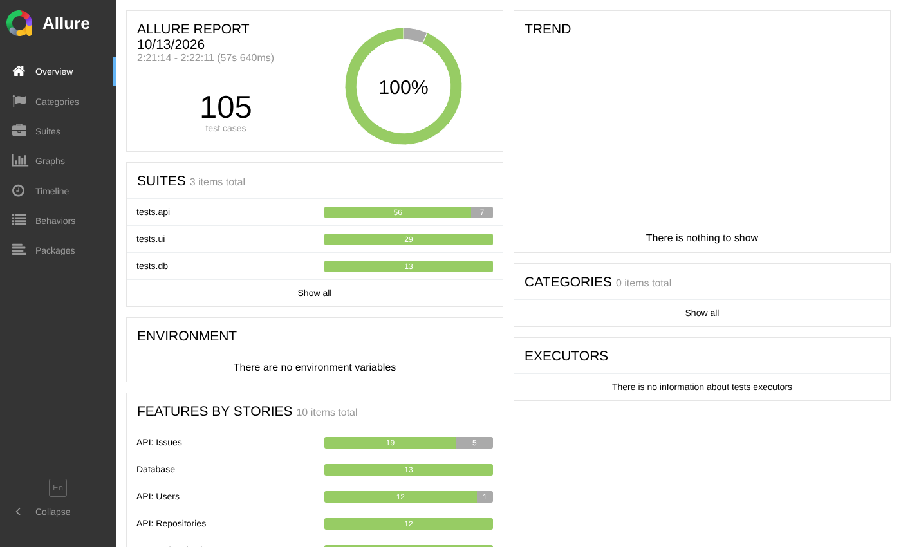
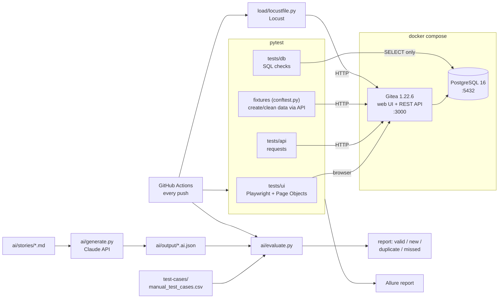

# QualityLens

A complete QA process on one real application: manual test design, UI, API, database and load
automation, CI with an Allure report, professional bug reports, and an AI test-case generator that is
measured against the hand-written suite.

The system under test is **[Gitea](https://about.gitea.com) 1.22.6**, an open-source Git service, running
locally in Docker with PostgreSQL.

| | |
|---|---|
| Manual test cases | 48, each traced to an automated test ([CSV](test-cases/manual_test_cases.csv)) |
| Automated tests | 162: 29 UI, 63 API, 13 database, 57 offline unit/traceability |
| Bugs found | 7 confirmed in Gitea 1.22.6, one of them found by the AI layer ([reports](bug-reports/README.md)) |
| Load test | 20 users, 0 % errors, p95 180 ms, with pass/fail thresholds ([baseline](load/README.md)) |
| AI generator | 94 % of the manual "Issues" cases reproduced; found a case the manual suite missed ([review](ai/output/create_issue.review.md)) |



## Architecture



## Run it

Needs Docker and Python 3.12+.

```bash
python -m venv .venv && source .venv/bin/activate
make install          # pip install -r requirements.txt + Playwright Chromium
make up               # start Gitea + Postgres, create the admin user (qa_admin)
make test             # everything, writes allure-results/
make report           # open the Allure report (needs Java)
```

Other targets: `make smoke | ui | api | db | unit | load | evidence | ai-eval | down`.
Gitea is then at http://localhost:3000 (user `qa_admin`, password `QaAdmin#2026`, local only).
Settings can be overridden with environment variables, see [.env.example](.env.example).

## What is where

```
docker-compose.yml        target app: Gitea + PostgreSQL, versions pinned
scripts/bootstrap.sh      start the app and create the admin account (idempotent)
qualitylens/              framework: config, API client, read-only DB helper, test data factory
pages/                    Page Objects (login, register, dashboard, repo, issues)
tests/ui|api|db|unit      automated tests, markers: smoke ui api db unit known_bug
sql/integrity_checks.sql  data-integrity rules, also runnable by hand in psql
load/                     Locust scenario with SLO thresholds, baseline results
test-cases/               manual test cases (CSV, opens in Excel)
bug-reports/              7 bug reports + evidence/ (HTTP logs, screenshots)
scripts/capture_evidence.py  reproduces every bug from scratch and refreshes evidence/
ai/                       story -> test cases (generate.py), comparison (evaluate.py), sample output + review
docs/test-plan.md         STLC test plan: scope, techniques, entry/exit criteria
.github/workflows/ci.yml  CI pipeline
```

## Coverage summary

| Feature | Manual | UI | API | DB | Notes |
|---|---|---|---|---|---|
| Login / logout | 7 | 8 | | | No account enumeration, masked password, session really ends |
| API authentication and authorisation | 2 | | 8 | | Bad credentials, invalid token, read-only token scope, non-admin blocked |
| Registration / users | 10 | 7 | 13 | 1 | Boundaries: 8-char password, 40-char username; case-insensitive email |
| Repositories | 6 | 7 | 12 | 2 | Name rules, 100-char limit, private repo hidden from anonymous users |
| Issues and comments | 18 | 7 | 24 | 3 | 255-char title, Unicode, XSS/SQL strings, state filter, pagination |
| Labels | 1 | | 6 | | Colour validation, duplicates |
| Data integrity | 4 | | | 7 rules | Counters, orphans, timestamps, primary email, lower-case names |
| **Total** | **48** | **29** | **63** | **13** | plus 57 offline unit and traceability tests |

Every manual case names the automated test that covers it, and `tests/unit/test_traceability.py` fails
the build if a referenced test is renamed or deleted.

## Bugs found

| ID | Summary | Severity |
|---|---|---|
| [BUG-001](bug-reports/BUG-001-whitespace-issue-title.md) | API accepts a whitespace-only issue title, stores an empty title | Major |
| [BUG-002](bug-reports/BUG-002-issue-title-silent-truncation.md) | Issue titles over 255 characters are silently truncated | Major |
| [BUG-003](bug-reports/BUG-003-duplicate-label-names.md) | Duplicate label names allowed in one repository | Minor |
| [BUG-004](bug-reports/BUG-004-misleading-password-error.md) | Short password reported as "PasswordIsRequired" | Minor |
| [BUG-005](bug-reports/BUG-005-unknown-state-filter-ignored.md) | Unknown `state` filter silently ignored | Minor |
| [BUG-006](bug-reports/BUG-006-malformed-json-error.md) | Malformed JSON gives 422 and a misleading message | Trivial |
| [BUG-007](bug-reports/BUG-007-whitespace-comment.md) | Whitespace-only comment accepted (found by the AI layer) | Minor |

Each is pinned by a test marked `known_bug` with `xfail(strict=True)`: the build stays green while the bug
exists and fails as soon as Gitea fixes it, which is the signal to turn it into a normal regression test.

## AI test-case generator

1. `ai/generate.py` sends a user story or API spec excerpt to Claude with a QA-engineer system prompt and a
   JSON schema, and gets back structured cases (title, type, priority, steps, data, expected result,
   acceptance criterion). Needs `ANTHROPIC_API_KEY`.
2. `ai/evaluate.py` compares them with the manual suite: bag-of-words cosine similarity (title weighted,
   synonyms normalised, success-vs-failure pairs penalised) and one-to-one matching. It reports
   **valid** (matches a manual case), **new** (needs human review), **duplicate** and **missed**.
3. A tester reviews the "new" cases by running them. See the
   [sample report](ai/output/create_issue.report.md) and [review](ai/output/create_issue.review.md).

Result on the "Create issue" story: 28 AI cases, 17 of 18 manual cases matched (94 %), 1 missed,
11 new. Running the new cases found **BUG-007**, and one review-level duplicate the evaluator did not flag.

The checked-in `create_issue.ai.json` is a sample produced by Claude from the same prompt while building
this repo; run `make ai-eval` with your own key to regenerate it. `ai/stories/user_registration.md` is a
second story ready to run.

## CI pipeline

`.github/workflows/ci.yml` runs on every push and pull request:

1. **unit**: offline tests of the evaluator and traceability (seconds).
2. **e2e**: starts Gitea + Postgres in the runner, runs smoke tests first, then the full UI/API/DB suite.
   Any unexpected failure, or a known bug that starts passing, fails the build. Builds the Allure report
   (artifact; also published to GitHub Pages on `main` once Pages is set to "GitHub Actions").
3. **load**: 60 s Locust run; fails on more than 1 % errors or p95 above 800 ms.
4. **ai-eval**: regenerates cases if an `ANTHROPIC_API_KEY` secret exists, then evaluates them.

## Design decisions

- **Page Object pattern**: selectors live in `pages/`, tests read like the manual steps. A UI change is
  fixed in one class.
- **Set up through the API, verify through the UI**: fixtures create repos, users and issues via REST and
  delete them afterwards, so UI tests are fast, independent and only exercise the behaviour under test.
- **Database is read-only for tests**: writing to it would bypass the application logic being tested.
- **Assert exact messages and status codes**: "it returned an error" hides wrong errors (BUG-004, BUG-006).
- **Evidence is code**: `capture_evidence.py` regenerates every log and screenshot, so a report can be
  re-checked on a new Gitea version in one command.

## Improvements

- Let Claude judge only borderline evaluator pairs (similarity 0.4 to 0.75) to catch paraphrased duplicates.
- Run the UI suite on Firefox and WebKit too (`--browser firefox`), and in parallel with `pytest-xdist`.
- Load test with 10,000 seeded issues to see whether the issue-list endpoint scales.
- Accessibility checks (axe-core) on the main pages; the blank-title row in BUG-001 is also an a11y issue.
- Contract tests generated from Gitea's OpenAPI spec (`/swagger.v1.json`).
