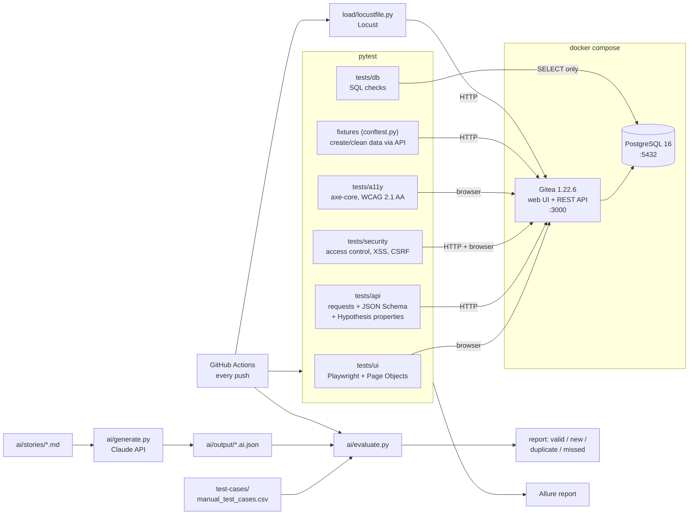

# QualityLens

A complete QA process on one real application: manual test design, UI, API, database, security,
accessibility, visual, property-based and load automation, mutation-tested framework code, CI with an Allure report, professional bug reports, and an AI test-case generator that is
measured against the hand-written suite.

The system under test is **[Gitea](https://about.gitea.com) 1.22.6**, an open-source Git service, running
locally in Docker with PostgreSQL.

| | |
|---|---|
| Manual test cases | 86, each traced to an automated test ([CSV](test-cases/manual_test_cases.csv)) |
| Automated tests | 444: 29 UI, 105 API, 13 database, 43 security, 13 accessibility, 9 visual, 232 offline unit/traceability |
| Bugs found | 12 confirmed in Gitea 1.22.6 (all still open in 28.2.0): one found by the AI layer, two by property-based tests ([reports](bug-reports/README.md)) |
| Security | Access control between users, stored XSS, CSRF, cookies, clickjacking, SQL metacharacters, path traversal |
| Property-based | Hypothesis generates hundreds of inputs per rule (any Unicode, odd numbers, unusual names) and a state machine checks random issue workflows against a model; found BUG-011 and BUG-012 ([details](#property-based-tests)) |
| Cross-browser | The UI suite runs on Chromium, Firefox and WebKit in CI |
| Accessibility | 9 screens scanned against WCAG 2.1 AA with axe-core, regressions fail the build ([audit](docs/accessibility.md)) |
| Visual regression | 8 screens compared pixel by pixel with approved baselines, in a pinned browser container so results match on every machine |
| Tests of the tests | 97 % branch coverage of the framework's logic and a 95.1 % mutation score, both gated in CI ([details](#testing-the-tests)) |
| Upgrade readiness | Weekly run of the whole suite on the pinned Gitea and on 28.x. On 28.2.0: all 10 bugs still open, a new 500 error, 6 new a11y violations ([report](docs/gitea-compatibility.md)) |
| CI | Parallel run (about 2 minutes for the browser, API and DB suites), Firefox/WebKit matrix, Allure trend history, per-layer run summary, weekly flake hunt and deep fuzz |
| Load test | 20 users, 0 % errors, p95 180 ms, with pass/fail thresholds and a trend check against recent runs ([baseline](load/README.md)) |
| AI generator | 94 % of the manual "Issues" cases reproduced; found a case the manual suite missed ([review](ai/output/create_issue.review.md)) |


## Architecture



## Run it

Needs Docker and Python 3.12+. **One command** installs everything, starts Gitea, runs the smoke tests,
then the full suite, and prints a summary:

```bash
bash scripts/run.sh                                         # Linux / macOS (or: make run)
powershell -ExecutionPolicy Bypass -File scripts\run.ps1    # Windows + Docker Desktop (-Report opens Allure, -Down cleans up)
```

Step by step:

```bash
python -m venv .venv && source .venv/bin/activate
make install          # pip install -r requirements.txt + Playwright Chromium
make up               # start Gitea + Postgres, create the admin user (qa_admin)
make test             # everything, writes allure-results/
make report           # open the Allure report (needs Java)
```

Other targets: `make fast | smoke | ui | api | db | security | a11y | property | fuzz | cross-browser | visual | visual-update | unit | coverage | mutation | load | flake-hunt | evidence | ai-eval | down`.
Gitea is then at http://localhost:3000 (user `qa_admin`, password `QaAdmin#2026`, local only).
Settings can be overridden with environment variables, see [.env.example](.env.example).
`GITEA_VERSION` picks another Gitea image (default `1.22.6`), see [retesting the bugs](bug-reports/README.md#triage-20-oct-2026).

**Windows (PowerShell, Docker Desktop):** there is no `make`, so run the commands behind each target:

```powershell
python -m venv .venv; .venv\Scripts\Activate.ps1
pip install -r requirements.txt; python -m playwright install chromium
docker compose up -d --wait
docker compose exec -T -u git gitea gitea admin user create --admin --username qa_admin `
  --password "QaAdmin#2026" --email qa_admin@example.com --must-change-password=false
pytest --alluredir=allure-results
```

## Demo in five minutes

A walkthrough for showing the project to someone, after `make up`:

1. **The app.** Open http://localhost:3000 and sign in as `qa_admin`. This is the system under test.
2. **Manual design.** Open [test-cases/manual_test_cases.csv](test-cases/manual_test_cases.csv): 86 cases, each
   naming the automated test that covers it. Run `pytest -m unit -q` to show the traceability check.
3. **Smoke, then everything.** `pytest -m smoke -q` (seconds), then `make fast`: about a minute on
   every CPU core, 175 passed and 21 xfailed, then the 7 integrity rules (`make test` runs the same suite on one core). Add `--headed -m ui` to watch the browser tests drive Gitea.
4. **A bug, live.** `pytest -m known_bug -rA` lists the twelve pinned defects. Reproduce one by hand:

   ```bash
   curl -s -u 'qa_admin:QaAdmin#2026' -H 'Content-Type: application/json' \
        -d '{"name":"demo"}' http://localhost:3000/api/v1/user/repos > /dev/null
   curl -s -u 'qa_admin:QaAdmin#2026' -H 'Content-Type: application/json' \
        -d '{"title":"   "}' http://localhost:3000/api/v1/repos/qa_admin/demo/issues
   ```

   Gitea answers `201` with `"title":""` (BUG-001); the issue list at
   http://localhost:3000/qa_admin/demo/issues shows a blank row. Then open
   [the bug report](bug-reports/BUG-001-whitespace-issue-title.md).
5. **Report.** `make report` opens Allure: results by feature, with the twelve known bugs shown as expected failures (xfail).
   In CI the report also has trend charts across runs, and each run's page shows a per-layer summary table.
6. **Security and accessibility.** `make security` (access control between two users, XSS, CSRF, injection)
   and `make a11y` (WCAG 2.1 AA scan of nine screens); the findings are in [docs/accessibility.md](docs/accessibility.md).
7. **Load.** `make load`: 60 s, 20 users, prints `LOAD TEST PASSED` with the error rate and p95.
8. **Visual regression.** `make visual` compares eight screens with `tests/visual/baseline/1.22.6/`.
   One test injects a red Sign In button and checks the comparison catches it; its diff image is in Allure.
9. **Generated inputs.** `make property` runs the Hypothesis tests; open
   [BUG-011](bug-reports/BUG-011-nul-character-500.md) for a bug no hand-written case had tried
   (`make fuzz` searches ten times harder with random seeds).
10. **Tests of the tests.** `make coverage` and `make mutation`: the framework's own logic is 96 % covered and
   96 % of deliberately planted bugs (mutants) are caught by the unit tests.
11. **AI layer.** Show [the evaluation report](ai/output/create_issue.report.md) and
   [the human review](ai/output/create_issue.review.md) that found BUG-007; `make ai-eval` re-runs it.

`make down` removes everything afterwards.

## What is where

```
docker-compose.yml        target app: Gitea + PostgreSQL, versions pinned
scripts/bootstrap.sh      start the app and create the admin account (idempotent)
qualitylens/              framework: config, API client, read-only DB helper, test data factory,
                          response schemas (schemas.py), axe-core wrapper (a11y.py),
                          expected-behaviour models for property tests (oracles.py)
pages/                    Page Objects (login, register, dashboard, repo, issues)
tests/ui|api|db|unit      automated tests, markers: smoke ui api db security a11y property unit serial known_bug
tests/api/test_properties.py  Hypothesis property and state-machine tests (profiles in tests/conftest.py)
tests/security            access control between users, XSS, CSRF, cookies, injection, traversal
tests/a11y                axe-core scans + baseline.json of known WCAG failures
tests/visual              screenshot comparison; baseline/<gitea version>/*.png are the approved looks
qualitylens/visual.py     pixel comparison with tolerance, diff image with changes in magenta
sql/integrity_checks.sql  data-integrity rules, also runnable by hand in psql
load/                     Locust scenario with SLO thresholds, baseline results
scripts/load_trend.py     load results vs the median of recent runs, per endpoint; history kept in CI cache
test-cases/               manual test cases (CSV, opens in Excel)
bug-reports/              12 bug reports + evidence/ (HTTP logs, screenshots)
scripts/capture_evidence.py  reproduces every bug from scratch and refreshes evidence/
ai/                       story -> test cases (generate.py), comparison (evaluate.py), sample output + review
docs/test-plan.md         STLC test plan: scope, techniques, entry/exit criteria
docs/accessibility.md     accessibility audit of Gitea 1.22.6
scripts/ci_summary.py     JUnit XML -> Markdown run summary; --runs finds flaky tests
scripts/compat_report.py  same suite on several Gitea versions -> what an upgrade breaks or fixes
scripts/mutation_score.py mutmut stats -> score and CI gate; config in setup.cfg (coverage: .coveragerc)
scripts/run.sh, run.ps1   one command from a fresh clone to a summarised run
docs/gitea-compatibility.md  upgrade report: Gitea 1.22.6 vs 28.2.0
.github/workflows/ci.yml  CI pipeline
.github/workflows/flake-hunt.yml  weekly: run the suite 3 times, fail on any test whose result changed
.github/workflows/deep-fuzz.yml   weekly: property tests with random seeds and 10x the examples
.github/workflows/gitea-compat.yml  weekly: whole suite on the pinned and newer Gitea, compatibility report
```

## Coverage summary

Manual cases per feature (`test-cases/manual_test_cases.csv`):

| Feature | Cases | Feature | Cases |
|---|---:|---|---:|
| Issues | 18 | Security | 10 |
| Registration | 10 | Property-based | 10 |
| Login | 7 | | |
| Repositories | 6 | API authentication | 6 |
| Milestones | 5 | Visual | 5 |
| Database integrity | 4 | Property-based | Hypothesis generates hundreds of inputs per rule (any Unicode, odd numbers, unusual names) and a state machine checks random issue workflows against a model; found BUG-011 and BUG-012 ([details](#property-based-tests)) |
| Cross-browser | The UI suite runs on Chromium, Firefox and WebKit in CI |
| Accessibility | 3 |
| Comments | 2 | **Total** | **86** |

Automated tests per layer (v1.0 run on Gitea 1.22.6):

| Layer | Tests | Highlights |
|---|---:|---|
| UI (Playwright, Page Objects) | 29 | Login and logout, registration rules, repository and issue flows; Chromium, Firefox, WebKit |
| API (requests + JSON Schema) | 105 | Boundaries, negative cases, response contracts, milestones, comments, 17 property-based; 21 pin known bugs |
| Database (SQL) | 13 | 7 whole-database integrity rules plus per-feature consistency checks |
| Security | 43 | Access control between two users, stored XSS, Markdown sanitiser, CSRF, cookies, clickjacking, injection |
| Accessibility (axe-core) | 13 | WCAG 2.1 AA on 9 screens against a baseline, keyboard-only sign-in, labelled fields |
| Visual | 9 | 8 screens against approved screenshots, plus a check that a small change is caught |
| Offline unit and traceability | 232 | Framework logic (97 % coverage, 95.1 % mutation score) and manual-to-automated links |
| **Total** | **444** | |

Every manual case names the automated test that covers it, and `tests/unit/test_traceability.py` fails
the build if a referenced test is renamed or deleted.

## Bugs found

| ID | Summary | Severity |
|---|---|---|
| [BUG-001](bug-reports/BUG-001-whitespace-issue-title.md) | API accepts a whitespace-only issue title, stores an empty title | Major |
| [BUG-002](bug-reports/BUG-002-issue-title-silent-truncation.md) | Issue titles over 255 characters are silently truncated | Major |
| [BUG-003](bug-reports/BUG-003-duplicate-label-names.md) | Duplicate label names allowed in one repository | Minor |
| [BUG-004](bug-reports/BUG-004-misleading-password-error.md) | Short password reported as "PasswordIsRequired" | Minor |
| [BUG-005](bug-reports/BUG-005-unknown-state-filter-ignored.md) | Unknown `state` filter silently ignored | Minor |
| [BUG-006](bug-reports/BUG-006-malformed-json-error.md) | Malformed JSON gives 422 and a misleading message | Trivial |
| [BUG-007](bug-reports/BUG-007-whitespace-comment.md) | Whitespace-only comment accepted (found by the AI layer) | Minor |
| [BUG-008](bug-reports/BUG-008-blank-milestone-title.md) | Milestones accept an empty or whitespace-only title | Minor |
| [BUG-009](bug-reports/BUG-009-unknown-ids-silently-dropped.md) | Unknown milestone or label IDs silently dropped on issue create | Minor |
| [BUG-010](bug-reports/BUG-010-search-like-wildcards.md) | Search treats `%` and `_` as SQL wildcards (not injection) | Minor |
| [BUG-011](bug-reports/BUG-011-nul-character-500.md) | A NUL character crashes six endpoints with a 500 and leaks the database error (found by property tests) | Major |
| [BUG-012](bug-reports/BUG-012-edit-title-not-validated.md) | Editing an issue title skips the rules applied on create (found by the state machine) | Minor |

Each is pinned by a test marked `known_bug` with `xfail(strict=True)`: the build stays green while the bug
exists and fails as soon as Gitea fixes it, which is the signal to turn it into a normal regression test.

## AI test-case generator

1. `ai/generate.py` sends a user story or API spec excerpt to Claude with a QA-engineer system prompt and a
   JSON schema, and gets back structured cases (title, type, priority, steps, data, expected result,
   acceptance criterion). Needs `ANTHROPIC_API_KEY`.
2. `ai/evaluate.py` compares them with the manual suite: bag-of-words cosine similarity (title weighted,
   synonyms normalised, success-vs-failure pairs penalised) and one-to-one matching. It reports
   **valid** (matches a manual case), **new** (needs human review), **duplicate** and **missed**.
3. A tester reviews the "new" cases by running them. See the
   [sample report](ai/output/create_issue.report.md) and [review](ai/output/create_issue.review.md).

Result on the "Create issue" story: 28 AI cases, 17 of 18 manual cases matched (94 %), 1 missed,
11 new. Running the new cases found **BUG-007**, and one review-level duplicate the evaluator did not flag.

The checked-in `create_issue.ai.json` is a sample produced by Claude from the same prompt while building
this repo; run `make ai-eval` with your own key to regenerate it. `ai/stories/user_registration.md` is a
second story ready to run.

## CI pipeline

`.github/workflows/ci.yml` runs on every push and pull request:

1. **unit**: offline tests of the framework, evaluator and traceability, with branch coverage (fails under 90 %).
   Then, in parallel with everything below: **mutation** (fails under a 90 % mutation score) and
   **visual** (screenshot comparison in the pinned Playwright container).
2. **e2e**: starts Gitea + Postgres in the runner, runs smoke tests first, then the full UI/API/DB suite.
   Any unexpected failure, or a known bug that starts passing, fails the build. Builds the Allure report
   (artifact on every run; also published to GitHub Pages on `main` when Pages is set to "GitHub Actions"
   and the repository variable `PUBLISH_PAGES` is `true`).
3. **cross-browser**: the UI suite on Firefox and WebKit (Chromium runs in **e2e**).
4. **load**: 60 s Locust run; fails on more than 1 % errors or p95 above 1200 ms (800 ms locally; shared CI runners are slower, see [load/README.md](load/README.md#ci)).
   Then compares every endpoint with the median of recent runs and fails if overall p95 is more than 50 % above it.
5. **ai-eval**: regenerates cases if an `ANTHROPIC_API_KEY` secret exists, then evaluates them.

Three scheduled workflows complete the picture: `flake-hunt.yml` (the suite 3 times, any changed result
fails), `deep-fuzz.yml` (property tests with random seeds and ten times the examples) and `gitea-compat.yml`
(the suite on every Gitea version in a matrix, then a comparison report).

## Testing the tests

A test suite is code too, and its helpers decide what "pass" means: if the visual comparison or the
evaluator's matching had a bug, tests could pass for the wrong reason. So the framework's logic has its
own checks:

- **Coverage** (`make coverage`): branch coverage of the logic modules measured by the offline unit
  tests, gated at 90 % (currently 97 %). Modules that only make sense against a live Gitea (API client,
  DB helper) are exercised by the e2e suite and excluded, see `.coveragerc`.
- **Mutation testing** (`make mutation`, [mutmut](https://github.com/boxed/mutmut)): mutmut makes about
  1,400 small changes to that logic (`>` to `>=`, `+=` to `=`, a changed string or constant) and re-runs the
  unit tests for each. A change no test notices "survives" and points at a missing assertion.
  The first run killed only 58 % of mutants. Going through the survivors showed real gaps: nothing
  checked that one AI case can match only one manual case, that the match and duplicate thresholds are
  inclusive, or what the evaluator's report and CLI actually print. The tests added for them raised the
  score to 96.4 %, and CI now fails below 90 %. With the property-test oracles and the load-trend script
  added it is 95.1 % (1,404 mutants). Most of the 69 survivors are equivalent mutants (for example
  `"PNG"` vs `"png"`, which Pillow treats the same) or command-line help text.

## Property-based tests

Example-based tests check the inputs someone thought of. `tests/api/test_properties.py` uses
[Hypothesis](https://hypothesis.readthedocs.io) to generate them instead, and checks rules that must hold
for every input:

- **Round trips**: any valid issue title is stored exactly as Gitea's Go code trims it; any issue body and
  any comment is stored byte for byte; label colours are normalised to six lower-case hex digits.
- **Oracles**: `qualitylens/oracles.py` models what Gitea *should* accept (repository name rules, title
  trimming with Go's whitespace set, which differs from Python's). The model is unit- and mutation-tested,
  so a disagreement points at Gitea, not at the test.
- **Robustness**: search on three endpoints and pagination with any numbers never return 5xx.
- **State machine**: random sequences of create, rename, close, reopen and comment, checked after every
  step against a plain Python dict: titles, states, comment counts and the repository's open-issue count.

When a rule breaks, Hypothesis shrinks the input to the smallest one that still breaks it. That is how
the suite found two bugs no hand-written case had tried: generated titles, bodies and search keywords
containing U+0000 showed that a NUL character crashes six endpoints and leaks the PostgreSQL error (**BUG-011**), and the state machine shrunk
a failing workflow to "create an issue, rename it to `'0\x85'`", which showed that edits skip the trimming
and blank-title check done on create (**BUG-012**). On Gitea 28.2.0 the repository-name rule also caught,
on its own, the `..` name that returns 500 there.

On every push the tests use a fixed seed (40 examples each), so a red build is always reproducible; the
weekly `deep-fuzz.yml` and `make fuzz` use random seeds and 400 examples.

## Visual regression

`tests/visual` takes full-page screenshots of eight screens (sign-in, sign-in error, registration,
404, new repository, empty repository, issue list, issue) and compares them with approved PNGs.

- **Same pixels everywhere**: fonts and anti-aliasing differ between machines, so the suite always runs in
  the pinned `mcr.microsoft.com/playwright/python:v1.56.0-noble` image (`make visual`), locally and in CI,
  with a fixed viewport, locale, time zone and colour scheme.
- **Stable data**: repositories and issues have fixed names; timestamps and render times are masked grey.
- **Tolerance**: a pixel counts as changed when a colour channel moves by more than 16/255; a screen fails
  above 0.2 % changed pixels or on any size change. Three runs in a row gave 0 changed pixels.
- **Guarding the guard**: one test turns the Sign In button red and asserts the comparison fails.
- **Reviewing a failure**: the actual image, the baseline and a diff (changes in magenta) go to Allure and
  to the `visual-diffs` CI artifact. An intended change is approved with `make visual-update`, and the new
  PNGs are reviewed in the pull request. Baselines are kept per Gitea version.

## Design decisions

- **Page Object pattern**: selectors live in `pages/`, tests read like the manual steps. A UI change is
  fixed in one class.
- **Set up through the API, verify through the UI**: fixtures create repos, users and issues via REST and
  delete them afterwards, so UI tests are fast, independent and only exercise the behaviour under test.
- **Database is read-only for tests**: writing to it would bypass the application logic being tested.
- **Assert exact messages and status codes**: "it returned an error" hides wrong errors (BUG-004, BUG-006).
- **Evidence is code**: `capture_evidence.py` regenerates every log and screenshot, so a report can be
  re-checked on a new Gitea version in one command.

## Improvements

- Let Claude judge only borderline evaluator pairs (similarity 0.4 to 0.75) to catch paraphrased duplicates.
- Record visual baselines for Gitea 28.x once the 14 UI tests that break on it are updated.
- Load test with 10,000 seeded issues to see whether the issue-list endpoint scales.
- Contract tests generated from Gitea's OpenAPI spec (`/swagger.v1.json`), for example with Schemathesis,
  to extend the property tests to every endpoint.
- Run the property tests against MySQL and SQLite builds of Gitea: BUG-011 is specific to PostgreSQL.
