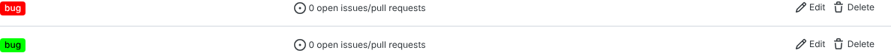

# BUG-003: Duplicate label names are allowed in one repository

| Field | Value |
|---|---|
| Severity | Minor |
| Priority | P3 |
| Component | REST API and UI, repository labels |
| Environment | Gitea 1.22.6 (Docker image `gitea/gitea:1.22.6`) + PostgreSQL 16, see `docker-compose.yml`. Chromium 141 via Playwright 1.56 for UI steps. |
| Found by | Exploratory API testing (uniqueness rules) |

## Steps to reproduce
1. `POST /api/v1/repos/qa_admin/<repo>/labels` with `{"name": "bug", "color": "#ff0000"}`.
2. Repeat with `{"name": "bug", "color": "#00ff00"}`.
3. `GET` the label list, and open `/qa_admin/<repo>/labels`.

## Expected result
The second request is rejected (409 or 422): a label name should identify one label in a repository.

## Actual result
Both requests return `201`. The repository now has two labels named `bug` (ids 1 and 2).

## Evidence
- [evidence/BUG-003.txt](evidence/BUG-003.txt)
- 

## Impact
Filtering by label name and label-based automation (`labels=bug`) become ambiguous; users apply the
"wrong" bug label and reports undercount.

## Notes
The database has no unique index on `label(repo_id, name)` (checked with `\d label`), so the rule is not
enforced at any layer.

## Regression test
`tests/api/test_labels_api.py::test_duplicate_label_name_rejected`
