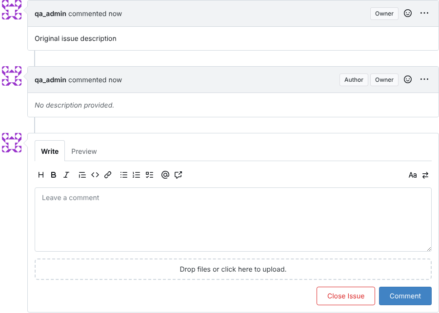

# BUG-007: Whitespace-only comment is accepted and shown as an empty comment

| Field | Value |
|---|---|
| Severity | Minor |
| Priority | P3 |
| Component | Issue comments: web UI and REST API `POST .../issues/{n}/comments` |
| Environment | Gitea 1.22.6 (Docker image `gitea/gitea:1.22.6`) + PostgreSQL 16, see `docker-compose.yml`. Chromium 141 via Playwright 1.56 for UI steps. |
| Found by | **AI-generated test case AI-19** (not in the hand-written suite; see `ai/output/create_issue.review.md`) |

## Steps to reproduce
UI:
1. Open an issue, type three spaces in the comment box, click **Comment**.

API:
1. `POST /api/v1/repos/qa_admin/<repo>/issues/<n>/comments` with `{"body": "   "}`

## Expected result
Rejected like an empty comment (`422 [Body]: Required` in the API, no new comment in the UI).

## Actual result
`201 Created`. A comment containing only spaces is stored and the timeline shows it as
"No description provided.", and it is counted in the issue's comment total.

## Evidence
- [evidence/BUG-007.txt](evidence/BUG-007.txt)
-  (top: the issue description; second: the blank comment)

## Impact
Accidental blank comments add noise to the timeline and inflate comment counts.
Same root cause family as BUG-001: whitespace is not treated as empty.

## Regression test
`tests/api/test_issues_api.py::test_whitespace_comment_rejected`
