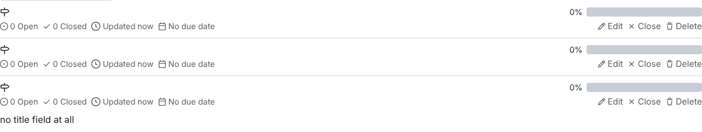

# BUG-008: Milestones can be created with an empty or whitespace-only title

| Field | Value |
|---|---|
| Severity | Minor |
| Priority | P3 |
| Component | Milestones: REST API `POST /api/v1/repos/{owner}/{repo}/milestones` and the web form |
| Environment | Gitea 1.22.6 (Docker image `gitea/gitea:1.22.6`) + PostgreSQL 16, see `docker-compose.yml`. Chromium 141 via Playwright 1.56 for UI steps. |
| Found by | Negative API testing of the new milestone suite (TC-API-MILESTONE-02) |

## Steps to reproduce
API:
1. `POST /api/v1/repos/qa_admin/<repo>/milestones` with `{"title": ""}`, then `{"title": "   "}`, then `{}`.

UI:
1. Open `/qa_admin/<repo>/milestones/new`, type three spaces as the title, click **Create Milestone**.

## Expected result
Rejected, as issues are: `422 [Title]: Required` in the API; a validation error on the form.

## Actual result
`201 Created` every time. The title is stored as an empty string. The milestone list shows rows with
no name at all, and the milestone picker on issues offers entries that cannot be told apart. The web
form's `required` attribute stops a truly empty title, but accepts spaces, which the server then trims
to nothing.

## Evidence
- [evidence/BUG-008.txt](evidence/BUG-008.txt)
- 

## Impact
Nameless milestones confuse release planning and cannot be chosen reliably when triaging issues.
Same family as BUG-001 and BUG-007: whitespace is not treated as empty.

## Regression test
`tests/api/test_milestones_api.py::test_milestone_title_required`
